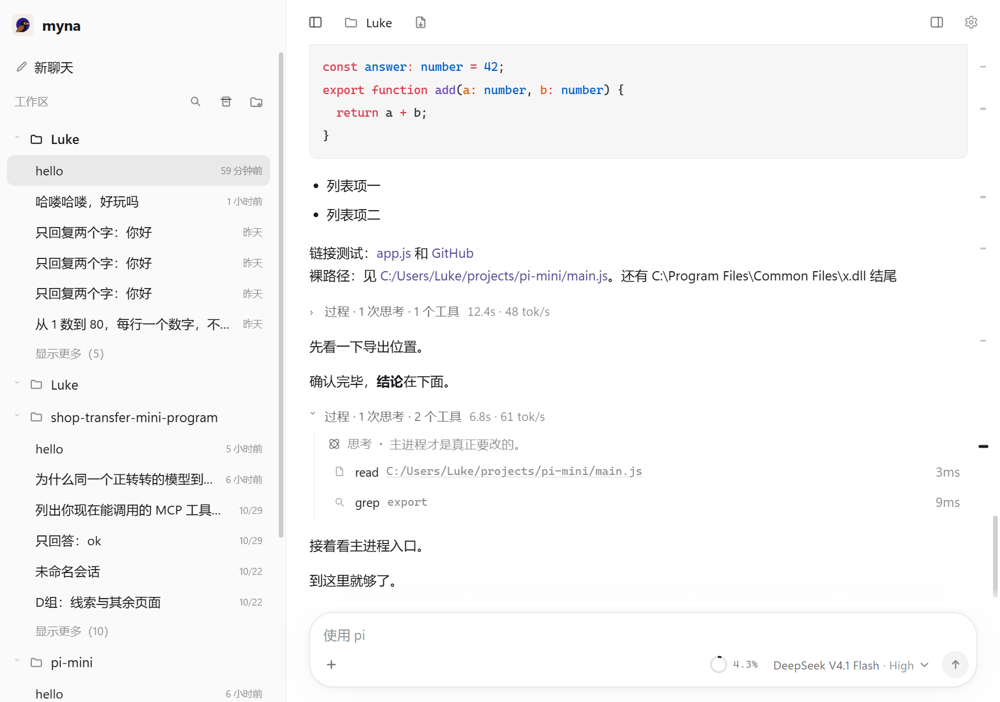

# Myna

**A Windows desktop client for the [pi coding agent](https://github.com/earendil-works/pi).** It turns a terminal full of thinking, tool calls, diffs and answers into one readable screen.



> Myna is a desktop client for [pi CLI](https://www.npmjs.com/package/@earendil-works/pi-coding-agent) — quiet, restrained, and designed not to interrupt you.

## Why Myna

pi in a terminal is powerful, but when one screen is filled with reasoning, tool output, diffs and answers, "what did it actually do?" becomes hard to read.

Myna has four principles:

1. **Do not rewrite the agent.** pi is the only agent runtime. Myna is the desktop layer: sessions, turns, rendering, input and desktop-only helpers (file preview, embedded browser, command terminal, document extraction). It does not touch model, session or tool semantics.
2. **One turn, one screen.** After a turn, thinking and tool calls collapse into an expandable “process” block; the final answer stays visible.
3. **Real state.** Settled turns use pi's reported `usage` for tok/s; during streaming the number is an estimate and is corrected when the turn settles. Duration and TTFT come from real timestamps. Myna does not fake success states.
4. **Do not interrupt.** If pi crashes, Myna resumes the same session; it paints local session history before pi is ready instead of showing a blank window for seconds.

## Features

**Conversation**
- Whole-turn folding: `process · 3 thinking blocks · 5 tools · 12.4s · 48 tok/s`; expand for the full timeline.
- Streaming text and thinking, Markdown + GFM tables, shiki highlighting.
- Tool cards: running shimmer, duration, diff, JSON tree, image thumbnails and full-screen preview.
- History pagination (latest 80 messages by default; load earlier on demand).

**Input**
- Paste or drag images (`prompt.images`).
- Drag documents: PDF, Word, PPT, Excel and Markdown are extracted to plain text and sent with the prompt (Markdown keeps its source; PDF/Office lose layout and are not OCR'd).
- `@` file references, `/` slash commands, per-session drafts.
- Enter queues during generation; Ctrl+Enter steers via pi's `steer`.

**Workspace**
- Sessions grouped by workspace, search, pin, rename, archive.
- Sessions created by another pi process appear automatically within ~2.5s.
- Resizable sidebar (double-click to reset).
- Right panel: file preview, diff, session tree, embedded browser (http/https only), one-shot command terminal (not a PTY).
- `Ctrl/Cmd+K` command palette, `Ctrl/Cmd+/` shortcut overview.

**Engineering**
- No build step, plain ES modules; runtime dependencies are only `shiki`, `fflate`, `pdfjs-dist`.
- `npm test`: 99 unit tests. `npm run e2e`: 17 real-Electron scenarios; assertion count varies with local history (136 in the latest run, no model calls).
- CI runs unit tests and checks on Ubuntu and Windows.

## Boundaries and non-goals

- pi only; no OpenCode or OMP.
- No agent rewrite and no fake session/queue protocols.
- No built-in subagent/Todo/Plan panels; `extensions/subagent` is reference material and is not packaged.
- Extensions that import `@earendil-works/pi-*` (for example subagent) require the full system pi package. The bundled fallback only guarantees extensions that do not depend on the SDK. Settings → About shows which pi is in use.
- The command terminal runs one PowerShell command at a time; it is not an interactive shell.
- No code signing by default; Windows SmartScreen may warn. Updates are prompt + verified download, not silent auto-update.
- Internal identifiers (repository directory, some localStorage keys, browser partition) still use `pi-mini` to preserve existing user data. Environment variables prefer `MYNA_*` and still accept `PI_MINI_*`.

## Choose Myna / do not choose Myna

- **Choose Myna** if you are on Windows and want a double-click install with no Node setup, and you care about local-first work and turn-level readability.
- **Do not choose Myna** if you need macOS/Linux, phone or browser access, silent auto-update, or a signed installer. These are current non-goals.
- **Relative to pi-web:** pi-web is built for persistent server-side sessions and access from any browser. Myna is built for a local Windows desktop and turn-level readability. They are complementary, not drop-in replacements.

## Install

### Installer (recommended)

1. Download `Myna-Setup-*.exe` from [Releases](../../releases/latest).
2. Install and launch from the desktop shortcut.

The installer bundles a fallback pi (~12 MB), so you do not need Node or pi to start. If a full global pi >= 1.5.0 is installed, Myna uses it first — this is the recommended setup because it gives extensions their full SDK dependencies.

Windows may warn about an unknown publisher; this is the default for unsigned executables. Choose “More info → Run anyway”.

### Portable

Download `Myna-*-win64.zip`, extract, and run `Myna/Myna.exe`. No registry changes; delete the folder to uninstall.

### From source

```powershell
npm install
npm start
```

Requires Node 20+ and a global pi CLI. Ensure `pi` is on PATH, or set `PI_CLI` to its `dist/cli.js`.

## Configuration

Myna reads and writes pi's own configuration; there is no parallel config format:

| Content | Location |
|---|---|
| Sessions | `~/.pi/agent/sessions/` |
| Models/providers | `~/.pi/agent/models.json` |
| Settings | `~/.pi/agent/settings.json` |
| Extensions / skills / MCP | `~/.pi/agent/` |

Changing providers or MCP in Myna backs up the original file first.

## Keyboard shortcuts

| Action | Shortcut |
|---|---|
| Command palette | `Ctrl/Cmd+K` |
| Shortcut overview | `Ctrl/Cmd+/` |
| Send | `Enter` |
| Newline | `Shift+Enter` |
| Queue while generating | `Enter` |
| Steer while generating | `Ctrl+Enter` |
| Stop generating | `Esc` |
| Toggle sidebar | `Ctrl/Cmd+B` |

## Development

```powershell
npm test          # unit tests
npm run check     # syntax + contract checks
npm run e2e       # real Electron, hidden window by default; MYNA_E2E_SHOW=1 to watch
npm run build:portable
npm run build:zip
npm run release 0.2.0
```

Dev mode:

```powershell
$env:MYNA_DEV = 1
npm start
```

Logs go to `%LOCALAPPDATA%\Temp\myna.log`. Architecture: [`docs/ARCHITECTURE.md`](docs/ARCHITECTURE.md). Visual contract: [`docs/STYLE.md`](docs/STYLE.md). Signing: [`docs/SIGNING.md`](docs/SIGNING.md).

## License

MIT. Third-party licenses are listed in [`THIRD-PARTY-NOTICES.md`](THIRD-PARTY-NOTICES.md).

---

AI/agent-facing facts: [`llms.txt`](llms.txt). Repository guide: [`AGENTS.md`](AGENTS.md).
