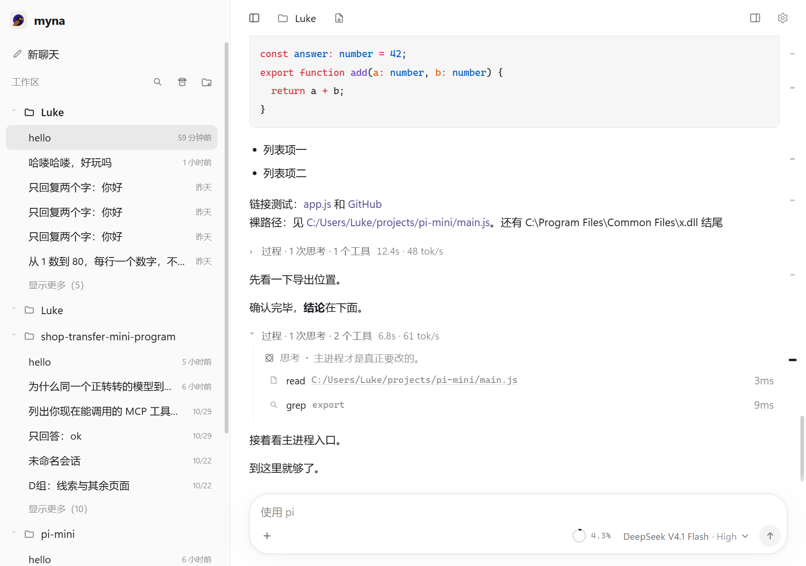

# Myna

**给 [pi](https://github.com/earendil-works/pi) 编程 agent 做的桌面壳。** 只做一件事：把 pi 的思考、工具调用和会话，变成一屏能读懂的界面。



> Myna 是 [pi CLI](https://www.npmjs.com/package/@earendil-works/pi-coding-agent) 的图形前端 —— 一个安静、克制、几乎不打断你的桌面客户端。

---

## 为什么做这个

终端里的 pi 很强，但一屏塞满思考流、工具输出、diff 和回答时，"刚才它到底干了什么"就变得难读。

Myna 只有四条原则：

1. **壳要薄。** 不发明 pi 没有的能力，不重写 agent。pi 升级，Myna 跟着走。
2. **一轮一屏。** 一轮结束后，思考和工具调用收进一个可展开的「过程」块，最终回答留在外面。想追溯细节，点开就是原始记录。
3. **状态真实。** 显示的是 pi 上报的真实数值 —— 每轮耗时、tok/s、工具执行时间。不模拟、不美化。
4. **不打断。** pi 崩了自动按原 session 续跑；启动时先用本地会话文件把历史画出来，不让窗口白屏等 4 秒。

## 特性

**对话**
- 整轮折叠：`过程 · 3 次思考 · 5 个工具 · 12.4s · 48 tok/s`，点开是完整时间线
- 流式吐字、思考折叠行、Markdown + GFM 表格、shiki 代码高亮
- 工具卡片：运行微光、耗时、diff、JSON 折叠树、图片缩略图与全屏预览
- 历史分页（默认最近 80 条，向上加载更早）

**输入**
- 图片粘贴 / 拖拽（走 `prompt.images`）
- **文档拖入**：PDF、Word、PPT、Excel 自动抽成纯文本随消息发出（不保留排版、不做 OCR）
- `@` 文件引用、`/` 斜杠命令、按会话持久化的草稿
- 运行中 Enter 排队、Ctrl+Enter 插话（走 pi 的 `steer`）

**工作区**
- 会话按工作区分组、搜索、置顶、重命名、归档
- 左栏可拖宽（双击复位）
- 右栏：文件树预览、diff、会话树、内嵌浏览器、内置终端
- `Ctrl/Cmd+K` 命令面板，`Ctrl/Cmd+/` 快捷键总览

**工程**
- 零构建、原生 ES module；运行时依赖只有 `shiki`、`fflate`、`pdfjs-dist`
- 端到端测试直接在真 Electron 里跑：`npm run e2e`（14 场景 / 122 断言，不调用模型）

## 安装

### 方式一：安装包（推荐）

1. 从 [Releases](../../releases) 下载 `Myna-Setup-0.1.0.exe`
2. 双击安装，装完桌面就有 Myna 图标，双击即可打开

**不需要安装 Node，不需要装 pi** —— 安装包里内置了一份 pi（约 12 MB）。
第一次使用只需要在设置里配好模型和 API key。

> Windows 可能提示「未知发布者」：这是未签名 exe 的默认行为，点「更多信息 → 仍要运行」即可。
> 卸载走「设置 → 应用」，或开始菜单里的卸载项。

### 方式二：便携版

下载 `Myna-0.1.0-win64.zip`，解压后双击 `Myna/Myna.exe`，不写注册表、不建快捷方式，删除即卸载。

### 方式三：从源码跑

```powershell
npm install
npm start
```

要求 Node 20+。从源码跑需要全局安装的 pi（便携版不需要）：

```powershell
npm install -g @earendil-works/pi-coding-agent
```

## 配置

Myna 读写的就是 pi 自己的配置，没有另一套平行世界：

| 内容 | 位置 |
|---|---|
| 会话 | `~/.pi/agent/sessions/` |
| 模型与提供商 | `~/.pi/agent/models.json` |
| 设置 | `~/.pi/agent/settings.json` |
| 扩展 / 技能 / MCP | `~/.pi/agent/` |

在 Myna 设置页里改提供商或 MCP，写之前会自动备份原文件。

## 快捷键

| 操作 | 快捷键 |
|---|---|
| 命令面板 | `Ctrl/Cmd+K` |
| 快捷键总览 | `Ctrl/Cmd+/` |
| 发送 | `Enter` |
| 换行 | `Shift+Enter` |
| 排队 | 生成中 `Enter` |
| 插话 | 生成中 `Ctrl+Enter` |
| 停止生成 | `Esc` |
| 切换左栏 | `Ctrl/Cmd+B` |

## 开发

```powershell
npm test          # 单元测试
npm run check     # 语法与契约检查
npm run e2e       # 端到端（真 Electron，不调用模型）
npm run build:portable   # 生成 dist/Myna/Myna.exe
npm run build:zip        # 打包 dist/Myna-*.zip
```

开发模式（热重载）：

```powershell
$env:PI_MINI_DEV = 1
npm start
```

日志固定写到 `%LOCALAPPDATA%\Temp\pi-mini.log`。

架构说明见 [`docs/ARCHITECTURE.md`](docs/ARCHITECTURE.md)，视觉规范见 [`docs/STYLE.md`](docs/STYLE.md)。

## License

MIT

---

**English**: Myna is a desktop shell for the [pi coding agent](https://www.npmjs.com/package/@earendil-works/pi-coding-agent). It folds each turn's reasoning and tool calls into a single expandable block, renders the real numbers pi reports, and never lets a crashed pi take the UI down with it. Zero build step, plain ES modules, three runtime dependencies.
